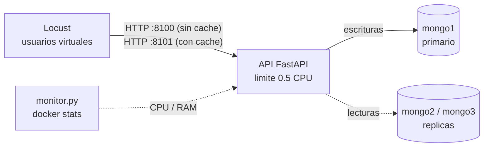
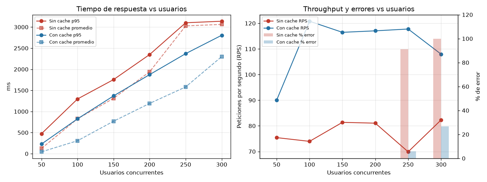
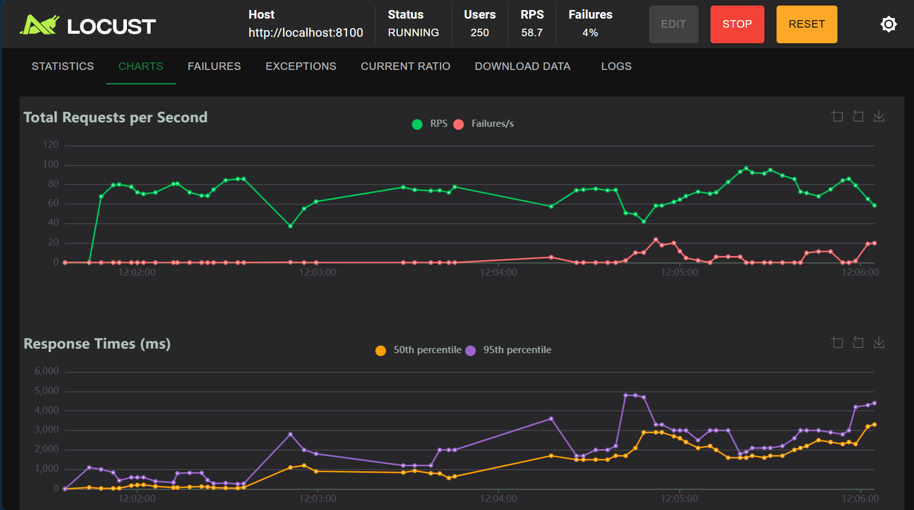
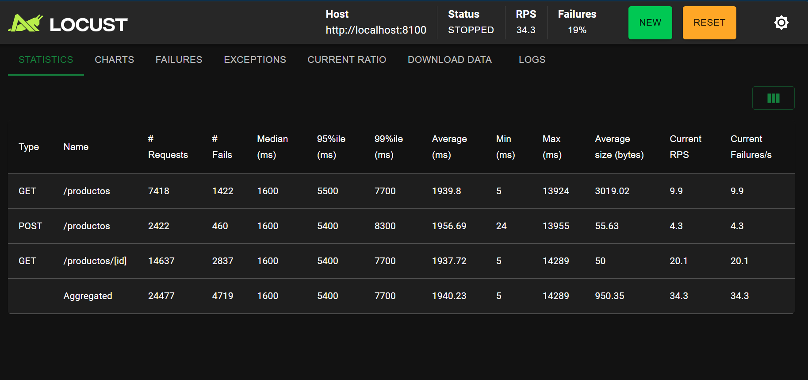
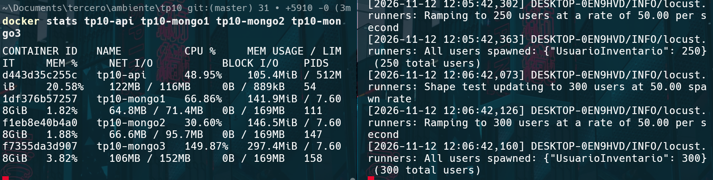

# TP10 – Monitoreo, Pruebas de Carga y Evaluación de Desempeño

| | |
|---|---|
| **Servicio evaluado** | API de inventario del TP8 (FastAPI + MongoDB Replica Set de 3 nodos) |
| **Herramienta de carga** | Locust (Python) |
| **Monitoreo de recursos** | `docker stats` (registrado con `monitor.py`) + Administrador de tareas |
| **Infraestructura** | Docker + Docker Compose |
| **Lenguaje** | Python 3 |

---

## Entorno de prueba

| | |
|---|---|
| **Procesador** | Intel Core i5-1235U (12.ª gen, 10 núcleos / 12 hilos) |
| **RAM** | 16gb |
| **Sistema operativo** | w11 |
| **Docker** | Docker Desktop 29.7.2 |
| **Límite de la API** | 0.5 CPU y 512 MB de RAM por contenedor |

> Se completa desde Configuración → Sistema → Información (o con `systeminfo` en la terminal).

**Por qué se limita la CPU de la API:** en una PC potente, 300 usuarios podrían no saturar la API y no aparecería el punto de quiebre. Con medio núcleo, el quiebre aparece seguro y la prueba se puede repetir igual en otra PC, por ejemplo la del laboratorio.

**Ojo:** Locust corre en la misma PC que el servidor, así que también consume CPU. Por eso el límite se pone solo en la API: así el cuello de botella queda en el servicio y no en la herramienta.

---

## Qué se probó



Cada usuario virtual hace, con una pausa de 0,2 a 0,8 s entre petición y petición:

| Peso | Petición | Qué hace |
|---|---|---|
| 60 % | `GET /productos/{id}` | ver un producto |
| 30 % | `GET /productos` | listar (máximo 50) |
| 10 % | `POST /productos` | crear un producto |

**Error** = respuesta 5xx, error de conexión o **timeout** (más de 3 s).

### Pruebas

| Prueba | Usuarios | Duración |
|---|---|---|
| **Carga normal** | 50 fijos | 3 min |
| **Estrés** | Escalones de 50 → 100 → 150 → 200 → 250 → 300 | 1 min cada escalón (6 min) |
| **Estrés con la mejora** | Igual que la anterior, contra la API con caché | 6 min |

---

## Estructura

```
tp10/
├── docker-compose.yml     # Mongo x3 + API original (:8100) + API con cache (:8101)
├── servicio/              # la API del TP8, sin logs por petición + cache opcional
├── locust/
│   ├── locustfile.py      # usuario virtual (carga normal)
│   └── estres.py          # rampa por escalones 50 -> 300
├── monitor.py             # guarda docker stats (CPU/RAM) en CSV durante la prueba
├── correr_pruebas.py      # corre las pruebas sin interfaz y guarda los CSV
├── reporte.py             # arma las tablas y el gráfico a partir de los CSV
└── resultados/            # CSV de Locust, CSV de recursos, reporte.md, grafico.png
```

---

## Cómo ejecutar

**1. Levantar el sistema** (Docker Desktop abierto; si el TP8 está levantado, apagarlo con `docker compose down` en `tp8`):

```bash
cd tp10
docker compose up -d --build
```

**2. Instalar Locust:**

```bash
python -m pip install locust matplotlib
```

**3. Correr las pruebas y generar el reporte:**

```bash
python correr_pruebas.py todo     # carga normal + estrés sin y con cache (~16 min)
python reporte.py                 # crea resultados/reporte.md y resultados/grafico.png
```

También se pueden correr por separado: `python correr_pruebas.py normal` o `python correr_pruebas.py estres`.

**4. Capturas con la interfaz web de Locust** (aparte de lo anterior):

```bash
python -m locust -f locust/estres.py --host http://localhost:8100
```

- Abrir `http://localhost:8089` y apretar **Start**. Los usuarios los maneja la rampa, así que lo que se escriba en el formulario no importa.
- En otra terminal: `docker stats tp10-api tp10-mongo1 tp10-mongo2 tp10-mongo3`.
- Para la carga normal con la interfaz: `python -m locust -f locust/locustfile.py --host http://localhost:8100`, con 50 usuarios.

**Si no aparece el punto de quiebre** (el p95 no sube y no hay errores), bajar la CPU de la API y repetir:

```powershell
$env:API_CPUS="0.25"; docker compose up -d
```

**Apagar:** `docker compose down -v`

---

## Resultados

> Las tablas salen de `resultados/reporte.md` (las genera `reporte.py`). Copiarlas acá.

### Carga normal (50 usuarios, 3 min)

_(pegar tabla de "Carga normal" de `resultados/reporte.md`)_

### Estrés: tiempo de respuesta vs usuarios

**Sin caché (original):**

_(pegar tabla "Estrés — sin cache")_

**Con caché (mejora):**

_(pegar tabla "Estrés — con cache")_



### Aciertos y errores en el pico de estrés

_(pegar "Aciertos y errores" de `resultados/reporte.md`)_

---

## Capturas

### 1. Locust en ejecución con usuarios virtuales



### 2. Resumen de resultados en Locust



### 3. CPU / RAM en el punto de quiebre



---

## Análisis: cuál fue el cuello de botella

Qué se ve al subir los usuarios:

1. **Con pocos usuarios** la latencia es baja y estable (unos pocos ms) y el throughput (RPS) crece igual que los usuarios.
2. **Cerca del quiebre**, alrededor de ___ usuarios, la **CPU de la API llega a su límite** (~50 % en `docker stats`, porque está limitada a 0,5 núcleos). Desde ahí el RPS **deja de crecer**.
3. **Pasado el quiebre**, las peticiones empiezan a hacer **cola**. El p95 se dispara (de ___ ms a ___ ms) y, cuando la espera supera los 3 s, aparecen **timeouts**: ___ % de error a 300 usuarios.
4. **MongoDB no es el problema:** los contenedores `mongo1/2/3` quedan con CPU baja. Cada consulta es por índice y tarda poco.

**Conclusión:** el cuello de botella es el **procesador de la API**. Es un solo proceso de Python (Uvicorn con 1 worker) y, por cada petición, tiene que consultar Mongo, convertir los documentos BSON a Python y armar el JSON. Todo eso es CPU. Los endpoints sincrónicos de FastAPI usan un grupo de hilos (40 por defecto), pero con el GIL de Python y medio núcleo los hilos no suman capacidad: solo esperan su turno.

---

## Mejora propuesta y medida: caché de lecturas

El 90 % de las peticiones son lecturas, y los datos casi no cambian de un segundo a otro. Por eso la API con caché (`:8101`, `CACHE_SEG=2`):

- guarda en memoria la **respuesta JSON ya armada** de cada lectura durante 2 s;
- si llega otra petición igual dentro de esos 2 s, responde desde memoria: no consulta Mongo ni vuelve a armar el JSON;
- cuando hay un `POST`, borra la lista guardada para no devolver datos viejos.

Resultado (comparar las dos tablas y el gráfico):

| | Sin caché | Con caché |
|---|---|---|
| p95 a 300 usuarios | ___ ms | ___ ms |
| % error a 300 usuarios | ___ % | ___ % |
| RPS máximo | ___ | ___ |
| CPU de la API a 300 usuarios | ___ % | ___ % |

Costo de la mejora: una lectura puede devolver datos de hasta 2 s de antigüedad (**consistencia eventual**, como en el TP8). Para un listado de inventario es aceptable.

### Otras mejoras posibles

| Mejora | Qué resuelve |
|---|---|
| Más workers de Uvicorn (`--workers 4`) con más CPU | Usar varios núcleos: un proceso por núcleo, sin el límite del GIL |
| Varias réplicas de la API detrás de un balanceador (Nginx) | Escalado horizontal: como la API es stateless, se pueden sumar copias |
| Caché compartida (Redis) | Igual que la caché actual, pero compartida entre varias copias de la API |
| Endpoints `async` con el driver `motor` | Que la API no bloquee hilos mientras espera a Mongo |
| Paginación en `GET /productos` | Respuestas más chicas, menos CPU por petición |
