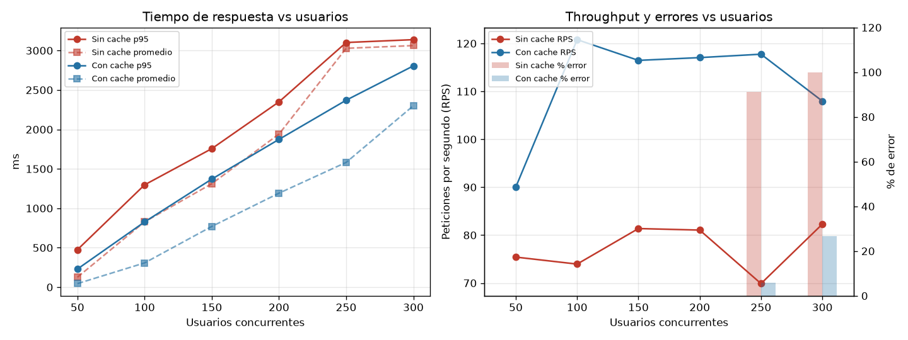

# Resultados

## Carga normal (50 usuarios)

| Endpoint | Peticiones | Errores | Prom (ms) | Mín (ms) | Máx (ms) | p90 (ms) | p95 (ms) | RPS |
|---|---|---|---|---|---|---|---|---|
| GET /productos | 4050 | 0 | 117 | 4 | 1280 | 330 | 530 | 23.6 |
| POST /productos | 1336 | 0 | 199 | 24 | 1394 | 460 | 630 | 7.8 |
| GET /productos/[id] | 8042 | 0 | 119 | 4 | 1279 | 340 | 560 | 46.8 |
| **Total** | 13428 | 0 | 126 | 4 | 1394 | 350 | 560 | 78.2 |

CPU API: promedio 40 % / máximo 56 %  —  RAM API máx 50 MB

## Estrés — sin cache (original)

| Usuarios | RPS | Prom (ms) | p50 (ms) | p90 (ms) | p95 (ms) | Máx (ms) | % error | CPU API máx | RAM API máx |
|---|---|---|---|---|---|---|---|---|---|
| 50 | 75.4 | 127 | 81 | 344 | 475 | 1200 | 0.0 % | 52 % | 50 MB |
| 100 | 74.0 | 828 | 781 | 1185 | 1297 | 2700 | 0.0 % | 53 % | 53 MB |
| 150 | 81.4 | 1312 | 1271 | 1668 | 1756 | 2300 | 0.0 % | 51 % | 54 MB |
| 200 | 81.0 | 1941 | 1854 | 2286 | 2349 | 3100 | 0.0 % | 52 % | 55 MB |
| 250 | 69.9 | 3028 | 2993 | 3040 | 3102 | 3300 | 91.1 % | 56 % | 67 MB |
| 300 | 82.3 | 3063 | 3024 | 3110 | 3138 | 3800 | 100.0 % | 54 % | 108 MB |

### Aciertos y errores — sin cache

Total: **28081** peticiones — **18776** OK (66.9 %) — **9305** con error (33.1 %)

| Método | Endpoint | Error | Cantidad |
|---|---|---|---|
| GET | /productos | ReadTimeout(ReadTimeoutError("HTTPConnectionPool(host='localhost', port=8100): Read timed  | 2780 |
| POST | /productos | ReadTimeout(ReadTimeoutError("HTTPConnectionPool(host='localhost', port=8100): Read timed  | 998 |
| GET | /productos/[id] | ReadTimeout(ReadTimeoutError("HTTPConnectionPool(host='localhost', port=8100): Read timed  | 5527 |

## Estrés — con cache (mejora)

| Usuarios | RPS | Prom (ms) | p50 (ms) | p90 (ms) | p95 (ms) | Máx (ms) | % error | CPU API máx | RAM API máx |
|---|---|---|---|---|---|---|---|---|---|
| 50 | 90.0 | 45 | 12 | 157 | 230 | 1200 | 0.0 % | 51 % | 49 MB |
| 100 | 120.8 | 308 | 249 | 679 | 827 | 2100 | 0.0 % | 53 % | 53 MB |
| 150 | 116.5 | 770 | 744 | 1259 | 1370 | 2400 | 0.0 % | 53 % | 53 MB |
| 200 | 117.0 | 1192 | 1096 | 1732 | 1874 | 3000 | 0.0 % | 52 % | 54 MB |
| 250 | 117.8 | 1582 | 1567 | 2288 | 2370 | 3100 | 5.9 % | 60 % | 56 MB |
| 300 | 108.0 | 2300 | 2278 | 2731 | 2805 | 3200 | 26.6 % | 59 % | 61 MB |

### Aciertos y errores — con cache

Total: **40636** peticiones — **38552** OK (94.9 %) — **2084** con error (5.1 %)

| Método | Endpoint | Error | Cantidad |
|---|---|---|---|
| GET | /productos | ReadTimeout(ReadTimeoutError("HTTPConnectionPool(host='localhost', port=8101): Read timed  | 639 |
| POST | /productos | ReadTimeout(ReadTimeoutError("HTTPConnectionPool(host='localhost', port=8101): Read timed  | 215 |
| GET | /productos/[id] | ReadTimeout(ReadTimeoutError("HTTPConnectionPool(host='localhost', port=8101): Read timed  | 1230 |

