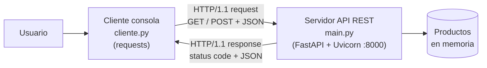
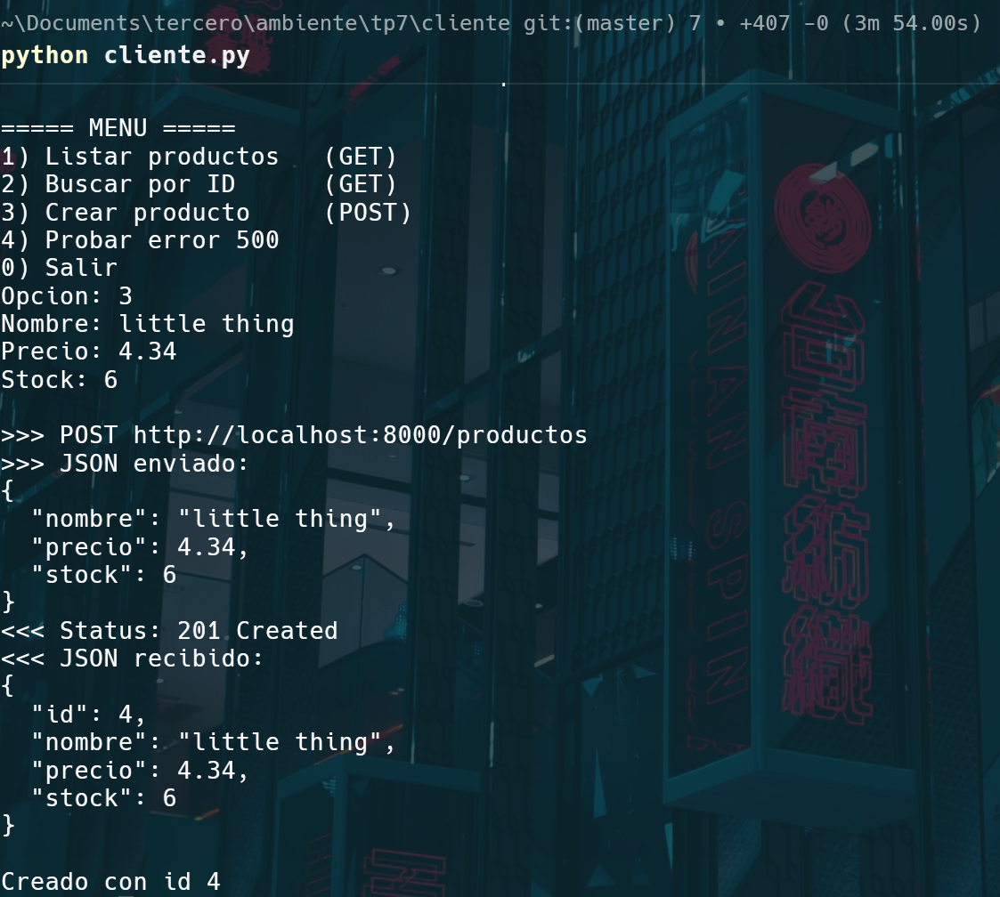
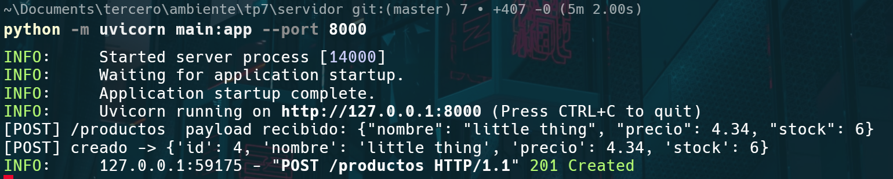
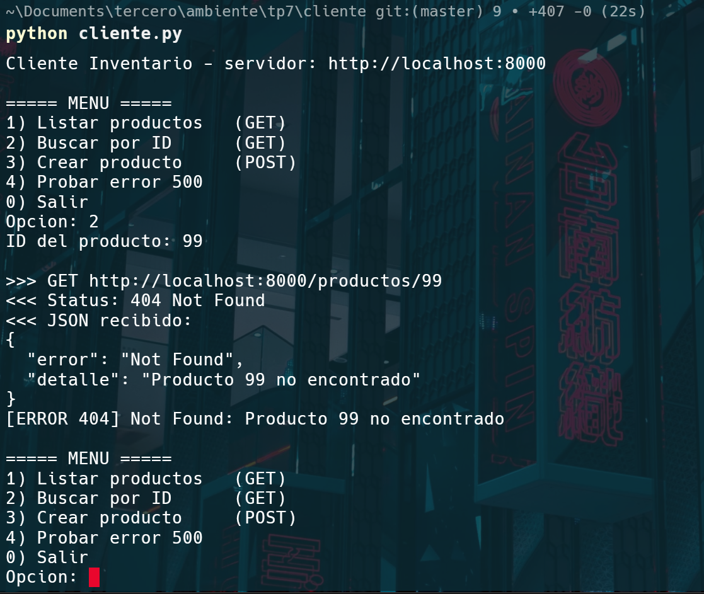

# TP7 – APIs y Servicios Web (REST)

| **Lenguaje** | Python 3 |
| **Frameworks** | FastAPI + Uvicorn (servidor), Requests (cliente) |
| **Tipo de API** | REST, JSON sobre HTTP/1.1 |

---

## Qué hace

API de **inventario de productos**. Cada producto tiene `id`, `nombre`, `precio` y `stock`. Los datos se guardan en memoria (al reiniciar el servidor vuelven los 3 productos de ejemplo).

- **Servidor:** expone los endpoints, valida los datos y responde con JSON.
- **Cliente:** programa de consola aparte. Manda las peticiones por HTTP y muestra el JSON que envía y el que recibe.

¿Por qué REST? Es comunicación cliente → servidor (North-South). Para ese caso conviene REST: JSON legible, fácil de probar y de depurar.

---

## Estructura

```
tp7/
├── README.md
├── capturas/
├── servidor/
│   ├── main.py            # API REST
│   └── requirements.txt
└── cliente/
    ├── cliente.py         # cliente de consola
    └── requirements.txt
```

---

## Endpoints

| Método | Ruta | Qué hace | Respuestas |
|---|---|---|---|
| GET | `/productos` | Lista todos los productos | 200 |
| GET | `/productos/{id}` | Trae un producto | 200 / 404 |
| POST | `/productos` | Crea un producto (JSON) | 201 / 400 |
| GET | `/error-simulado` | Fuerza un fallo para probar el 500 | 500 |

**Ejemplo de POST:**

```json
{ "nombre": "Teclado RGB", "precio": 25000.5, "stock": 7 }
```

**Respuesta (201 Created):**

```json
{ "id": 4, "nombre": "Teclado RGB", "precio": 25000.5, "stock": 7 }
```

---

## Arquitectura



Flujo de una petición:

1. El cliente arma un `dict` de Python y `requests` lo convierte a texto JSON (**marshalling**).
2. Viaja por HTTP/1.1 sobre TCP.
3. FastAPI lee el JSON y lo convierte a un objeto `ProductoNuevo`, validando tipos y reglas (**unmarshalling**).
4. El servidor procesa y responde con un código de estado y JSON.
5. El cliente hace `resp.json()` (**unmarshalling**) y lo muestra.

---

## Manejo de errores

**Servidor:** todos los errores salen con el mismo formato:

```json
{ "error": "Not Found", "detalle": "Producto 99 no encontrado" }
```

| Código | Cuándo |
|---|---|
| **400 Bad Request** | JSON mal formado, falta un campo, tipos incorrectos, precio ≤ 0, stock < 0, nombre vacío o repetido |
| **404 Not Found** | El producto o la ruta no existen |
| **500 Internal Server Error** | Cualquier excepción no prevista. No se muestran detalles internos al cliente, solo en la consola del servidor |

FastAPI por defecto devuelve 422 en los errores de validación. Lo cambié a **400**, que es lo que pide el TP.

**Cliente:**

- Muestra el código de estado y el mensaje de error del servidor (4xx / 5xx).
- Servidor apagado → captura `ConnectionError` y avisa, sin romperse.
- Servidor colgado → timeout de 5 s.
- Respuesta que no es JSON → la captura y avisa.

---

## Cómo ejecutar

Requisito: Python 3.9 o superior.

**1. Servidor** (terminal 1):

```bash
cd tp7/servidor
pip install -r requirements.txt
uvicorn main:app --port 8000
```

Si no encuentra `uvicorn`, usar: `python -m uvicorn main:app --port 8000`

**2. Cliente** (terminal 2):

```bash
cd tp7/cliente
pip install -r requirements.txt
python cliente.py                      # o: python cliente.py http://<ip>:8000
```

**Extra:** con el servidor levantado, en el navegador ir a `http://localhost:8000/docs`. FastAPI genera ahí la documentación de la API y permite probar los endpoints.

### Pruebas sugeridas

| Opción del menú | Entrada | Resultado |
|---|---|---|
| 1 | — | 200, lista de 3 productos |
| 2 | `2` | 200, Mouse |
| 2 | `99` | 404 Not Found |
| 3 | `Teclado RGB`, `25000.50`, `7` | 201 Created, id 4 |
| 3 | nombre vacío, `-5`, `abc` | 400 con los 3 errores |
| 3 | `Mouse`, `100`, `1` | 400, nombre repetido |
| 4 | — | 500 Internal Server Error |
| cualquiera, con el servidor apagado | — | "No se pudo conectar" |

---

## Evidencias

### Captura 1 – Invocación exitosa



### Captura 2 – Estructura de datos (JSON)



### Captura 3 – Manejo de errores


