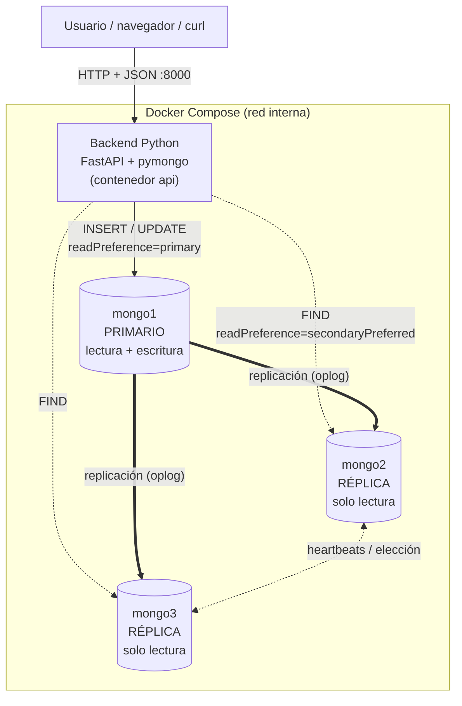
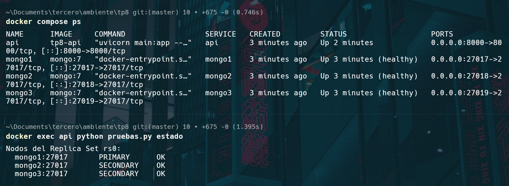
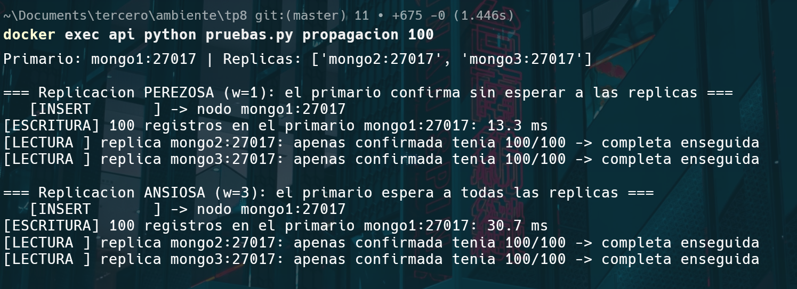
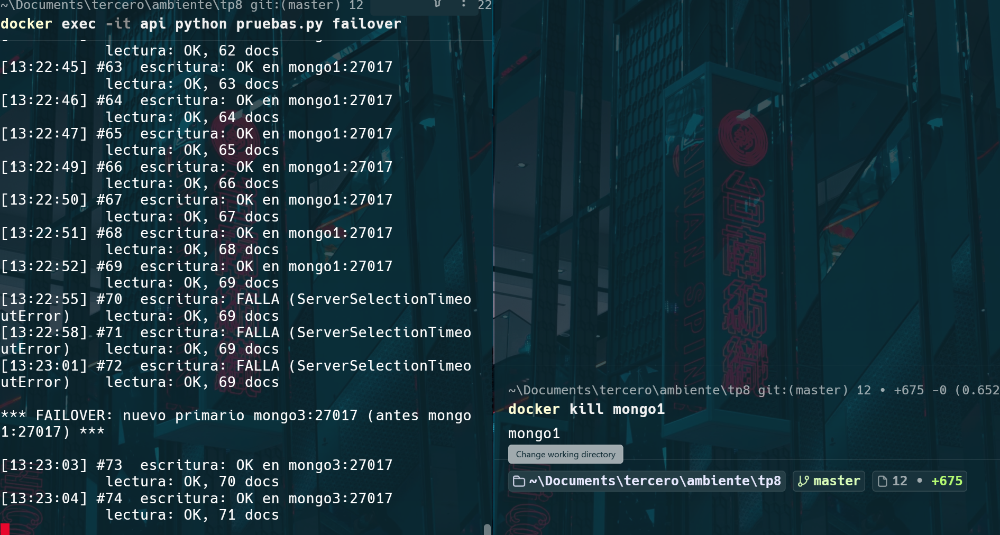

# TP8 – Bases de Datos Distribuidas y Conexión entre Capas

| | |
|---|---|
| **Lenguaje** | Python 3.12 |
| **Backend** | FastAPI + Uvicorn |
| **Base de datos** | MongoDB 7 – Replica Set (1 primario + 2 réplicas) |
| **Conexión a la BD** | Driver nativo `pymongo` |
| **Infraestructura** | Docker + Docker Compose |
| **Opción elegida** | A – Replicación (Copia Primaria / Respaldo-Primario) |

---

## Qué hace

- 3 nodos MongoDB en Docker forman un **Replica Set** (`rs0`).
- **Primario** (`mongo1`): recibe todas las escrituras.
- **Réplicas** (`mongo2`, `mongo3`): copian todo del primario. Se usan para leer.
- **Backend**: la API de inventario del TP7, pero ahora guarda en MongoDB en vez de en memoria.
  - Escrituras (POST) → primario.
  - Lecturas (GET) → réplicas.
- Si se cae el primario, los nodos que quedan **eligen un primario nuevo solos** (failover automático).

---

## Arquitectura



---

## Estructura

```
tp8/
├── docker-compose.yml     # 3 nodos Mongo + init + backend
├── README.md
├── capturas/
└── backend/
    ├── Dockerfile
    ├── requirements.txt
    ├── db.py              # conexiones: escritura -> primario, lectura -> réplicas
    ├── init_replica.py    # arma el Replica Set la primera vez
    ├── main.py            # API REST
    └── pruebas.py         # pruebas de propagación y failover
```

---

## Separación lectura / escritura

En `db.py` hay **dos conexiones** al mismo Replica Set:

```python
URI = "mongodb://mongo1:27017,mongo2:27017,mongo3:27017/?replicaSet=rs0"

cliente_escritura = MongoClient(URI, readPreference="primary", w="majority")
cliente_lectura   = MongoClient(URI, readPreference="secondaryPreferred")
```

- **Escritura:** el driver siempre manda las escrituras al nodo que en ese momento es primario. Si cambia el primario, lo encuentra solo.
- **`w="majority"`:** el primario confirma cuando la mayoría (2 de 3) tiene el dato.
- **Lectura:** `secondaryPreferred` hace que lea de una réplica. Si no queda ninguna réplica viva, lee del primario.
- En la consola de la API se ve **a qué nodo fue cada operación**:

```
[API] POST /productos {'nombre': 'Webcam', ...}  (ESCRITURA -> primario)
   [INSERT       ] -> nodo mongo1:27017
[API] GET /productos  (LECTURA -> replica)
   [FIND         ] -> nodo mongo3:27017
```

---

## Cómo ejecutar

Requisito: Docker Desktop abierto.

```bash
cd tp8
docker compose up -d --build
```

La primera vez tarda porque baja las imágenes. `init-replica` arma el cluster y termina; aparece como `Exited (0)`, y eso es normal.

**Ver el cluster:**

```bash
docker compose ps
docker exec api python pruebas.py estado
```

**API:**

- `http://localhost:8000/docs` → probar los endpoints desde el navegador
- `GET /productos` y `GET /productos/{id}` → leen de una réplica
- `POST /productos` → escribe en el primario
- `GET /cluster` → estado de los nodos

**Logs de la API** (para ver a qué nodo va cada operación):

```bash
docker logs -f api
```

**Apagar:**

```bash
docker compose down        # apaga (los datos quedan en los volúmenes)
docker compose down -v     # apaga y borra todo
```

---

## Prueba 1: Propagación (ansiosa vs perezosa)

```bash
docker exec api python pruebas.py propagacion 100
```

Qué hace:

1. Escribe 100 registros en el primario.
2. Se conecta **directo a cada réplica** y cuenta cuántos registros tiene apenas el primario confirmó.
3. Lo hace dos veces:
   - **Perezosa (`w=1`):** el primario confirma sin esperar a las réplicas.
   - **Ansiosa (`w=3`):** el primario confirma recién cuando las 3 copias lo tienen.

Ejemplo de salida:

```
=== Replicacion PEREZOSA (w=1): el primario confirma sin esperar a las replicas ===
[ESCRITURA] 100 registros en el primario mongo1:27017: 8.8 ms
[LECTURA ] replica mongo2:27017: apenas confirmada tenia 0/100 -> completa despues de ~15 ms
[LECTURA ] replica mongo3:27017: apenas confirmada tenia 100/100 -> completa enseguida

=== Replicacion ANSIOSA (w=3): el primario espera a todas las replicas ===
[ESCRITURA] 100 registros en el primario mongo1:27017: 10.2 ms
[LECTURA ] replica mongo2:27017: apenas confirmada tenia 100/100 -> completa enseguida
[LECTURA ] replica mongo3:27017: apenas confirmada tenia 100/100 -> completa enseguida
```

Conclusión:

- **Perezosa:** responde más rápido, pero una réplica puede no tener el dato todavía (0/100). Llega unos ms después → **consistencia eventual**.
- **Ansiosa:** tarda un poco más, pero las réplicas ya tienen todo → **consistencia fuerte**.
- Los tiempos cambian en cada ejecución. En la misma PC la replicación tarda milisegundos; en red real tardaría más.

---

## Prueba 2: Caída del primario (failover)

Terminal 1:

```bash
docker exec -it api python pruebas.py failover
```

Escribe y lee cada 1 segundo y muestra en qué nodo escribió.

Terminal 2, mientras corre:

```bash
docker kill mongo1      # caída abrupta (o docker stop mongo1 para un apagado ordenado)
```

Más tarde, para que vuelva:

```bash
docker start mongo1
```

Ejemplo de salida:

```
[13:05:46] #5   escritura: OK en mongo1:27017                   lectura: OK, 4 docs
[13:05:49] #6   escritura: FALLA (ServerSelectionTimeoutError)  lectura: OK, 5 docs
[13:05:52] #7   escritura: FALLA (ServerSelectionTimeoutError)  lectura: OK, 5 docs
[13:05:55] #8   escritura: FALLA (ServerSelectionTimeoutError)  lectura: OK, 5 docs

*** FAILOVER: nuevo primario mongo2:27017 (antes mongo1:27017) ***

[13:05:57] #9   escritura: OK en mongo2:27017                   lectura: OK, 6 docs
...
*** FAILOVER: nuevo primario mongo1:27017 (antes mongo2:27017) ***      <- al volver mongo1
[13:06:19] #31  escritura: OK en mongo1:27017                   lectura: OK, 28 docs
```

Qué pasa:

1. **Se cae el primario** → las escrituras fallan con `ServerSelectionTimeoutError`, porque no hay primario.
2. **Las lecturas siguen andando**: las réplicas siguen vivas.
3. **Elección:** las réplicas dejan de recibir heartbeats del primario. Unos **10 s** después votan y `mongo2` pasa a ser primario. Para elegir hace falta mayoría: 2 de 3 nodos.
4. **El driver se da cuenta solo** y las escrituras vuelven a andar, sin cambiar nada en el código.
5. **Vuelve `mongo1`:** se pone al día copiando lo que se perdió y, como tiene más prioridad (`priority: 2`), recupera el rol de primario.

La **API** en ese momento:

- `GET /productos` → sigue respondiendo (lee de una réplica).
- `POST /productos` → responde **503 Service Unavailable** mientras no hay primario:
  ```json
  {"error": "Service Unavailable", "detalle": "Base de datos no disponible (ServerSelectionTimeoutError)"}
  ```
- Después de la elección, el `POST` vuelve a funcionar solo.

Un detalle: en la lectura a veces el número de documentos es menor que el de escrituras (por ejemplo, la #4 escribió el 4.º documento pero leyó 3). Es la **consistencia eventual**: la réplica todavía no había recibido la última escritura.

---

## Manejo de errores en el backend

| Caso | Respuesta |
|---|---|
| Datos inválidos | 400 Bad Request |
| Nombre repetido (índice único en Mongo) | 400 Bad Request |
| Producto no existe | 404 Not Found |
| Sin primario, nodo caído o timeout (`PyMongoError`) | 503 Service Unavailable |
| Otro error | 500 Internal Server Error |

El timeout para encontrar un nodo es de 3 s (`serverSelectionTimeoutMS`), así la API no queda colgada.

---

## Capturas

### 1. Cluster en ejecución

`docker compose ps` + `docker exec api python pruebas.py estado`



### 2. Escritura en primario y lectura en réplica

`docker exec api python pruebas.py propagacion 100`



### 3. Caída del primario

`pruebas.py failover` + `docker kill mongo1`


