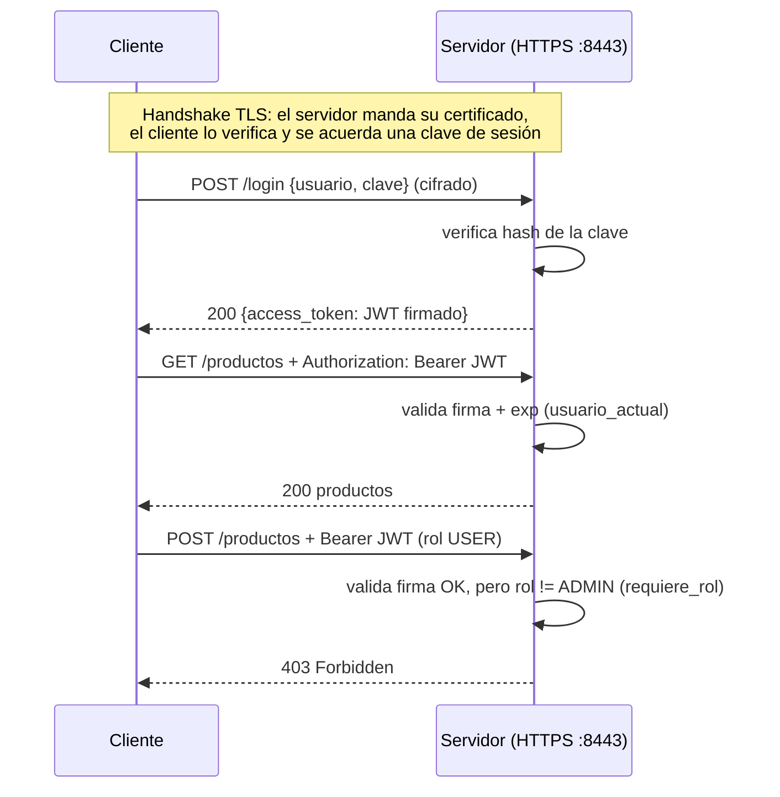
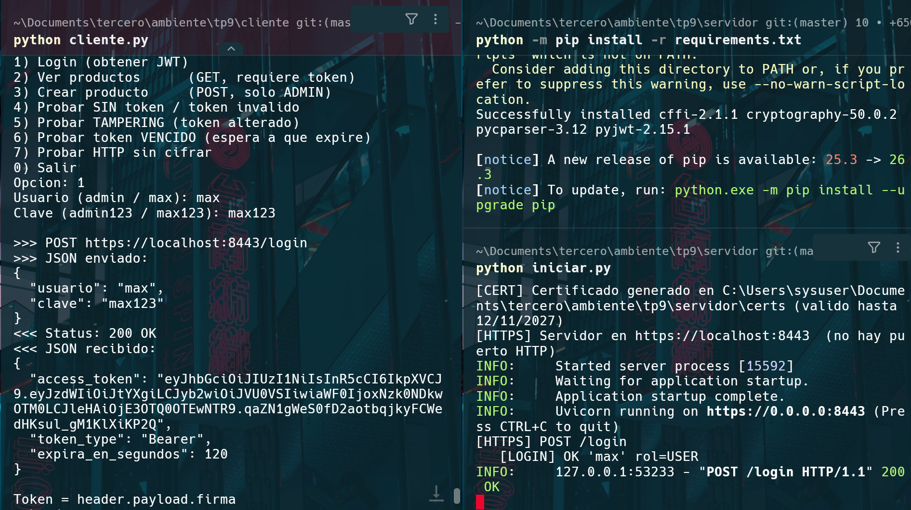
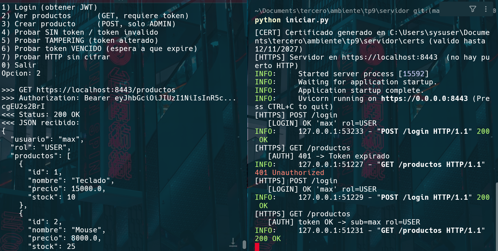
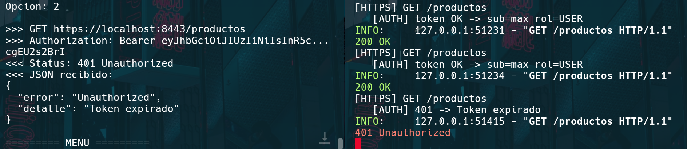
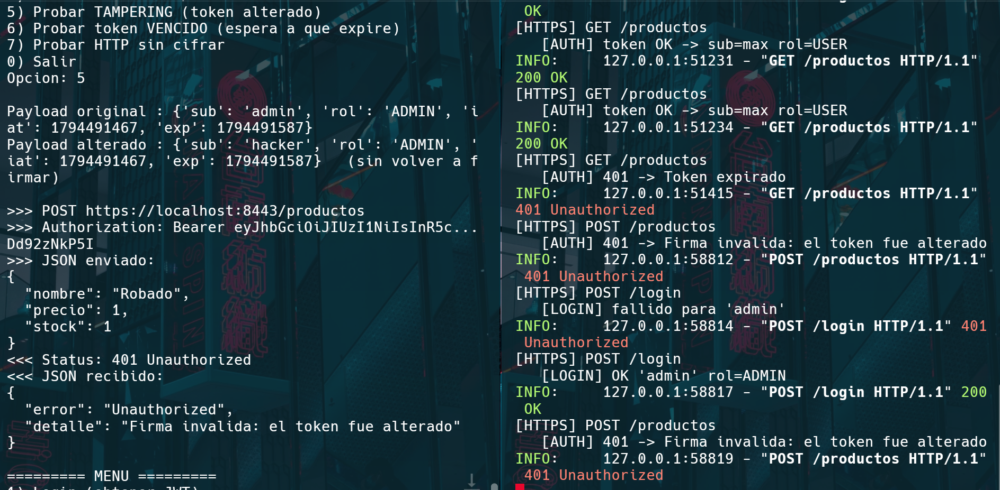

# TP9 – Seguridad en Aplicaciones Distribuidas (JWT y TLS/SSL)

| | |
|---|---|
| **Lenguaje** | Python 3 |
| **Servidor** | FastAPI + Uvicorn (HTTPS) |
| **JWT** | PyJWT, firma HS256 |
| **Certificado TLS** | Autofirmado, generado con `cryptography` (equivalente a OpenSSL) |
| **Cliente** | Consola con `requests` |

---

## Qué hace

API de inventario protegida con dos capas:

1. **TLS/HTTPS:** todo el tráfico va cifrado. El servidor escucha **solo HTTPS** en el puerto 8443; no hay puerto HTTP.
2. **JWT:** para usar la API primero hay que hacer login. El servidor devuelve un token firmado, y en cada petición se manda en el header `Authorization: Bearer <token>`.

| Endpoint | Quién puede | Si no cumple |
|---|---|---|
| `POST /login` | Cualquiera | 401 si el usuario o la clave están mal |
| `GET /productos` | Cualquier usuario con token válido | 401 |
| `POST /productos` | Solo rol **ADMIN** | 401 sin token o con token inválido / 403 si es USER |

Usuarios de prueba:

| Usuario | Clave | Rol |
|---|---|---|
| `admin` | `admin123` | ADMIN |
| `max` | `max123` | USER |

Las claves no se guardan en texto plano: se guarda un hash (PBKDF2-SHA256 con salt).

---

## Estructura

```
tp9/
├── README.md
├── capturas/
├── servidor/
│   ├── iniciar.py               # levanta la API solo por HTTPS (genera el certificado si falta)
│   ├── generar_certificado.py   # certificado autofirmado -> certs/cert.pem + certs/key.pem
│   ├── seguridad.py             # login, creación y validación de JWT, control de roles
│   ├── main.py                  # endpoints
│   └── requirements.txt
└── cliente/
    ├── cliente.py               # menú de pruebas
    └── requirements.txt
```

`certs/` no se sube a git porque tiene la clave privada. Cada uno lo genera al levantar el servidor.

---

## Flujo



---

## 1. Canal seguro (TLS/HTTPS)

- `generar_certificado.py` crea un **par de claves RSA 2048** y un **certificado X.509 autofirmado** para `localhost` y `127.0.0.1`, válido por 1 año.
- Comando equivalente con OpenSSL:
  ```bash
  openssl req -x509 -newkey rsa:2048 -nodes -days 365 -keyout certs/key.pem -out certs/cert.pem -subj "/CN=localhost" -addext "subjectAltName=DNS:localhost,IP:127.0.0.1"
  ```
- `iniciar.py` levanta Uvicorn con `ssl_certfile` y `ssl_keyfile`. Solo existe el puerto HTTPS.
- **El cliente verifica el certificado**: usa `verify=cert.pem`. No usa `verify=False`, que desactivaría la protección contra un Man-in-the-Middle.
- Si se intenta hablar **HTTP sin cifrar** al puerto 8443, el servidor corta la conexión.

---

## 2. JWT

El token tiene 3 partes: `header.payload.firma` (cada parte en base64url).

```json
header : {"alg": "HS256", "typ": "JWT"}
payload: {"sub": "max", "rol": "USER", "iat": 1794490528, "exp": 1794490648}
firma  : HMAC-SHA256(header + "." + payload, CLAVE_SECRETA)
```

- `sub` = usuario, `rol` = permisos, `exp` = vencimiento (**2 minutos**), `iat` = cuándo se emitió.
- **Ojo:** el payload **no está cifrado**, solo codificado. Cualquiera lo puede leer, y el cliente lo muestra. Lo que lo protege es la **firma**: no se puede cambiar sin la clave secreta.
- **Sin estado (stateless):** el servidor no guarda sesiones. Cada petición trae el token y alcanza con verificar la firma.

---

## 3. Middleware de autorización (`seguridad.py`)

- **`usuario_actual`**: lee `Authorization: Bearer`, verifica la firma y el `exp`. Responde **401** si:
  - falta el token,
  - el token está mal formado,
  - la firma no coincide (el token fue alterado),
  - el token venció.
- **`requiere_rol("ADMIN")`**: si el token es válido pero el rol no alcanza → **403**.
- `algorithms=["HS256"]` está fijo: el servidor no acepta tokens con `"alg": "none"` ni con otro algoritmo.

Diferencia entre los dos códigos:

- **401:** no sé quién sos (no hay token o el token no sirve).
- **403:** sé quién sos, pero no tenés permiso.

---

## 4. Tampering (alteración del token)

La opción 5 del cliente:

1. Toma el token de `max` (rol USER).
2. Decodifica el payload y lo cambia a `{"sub": "hacker", "rol": "ADMIN"}`.
3. Lo vuelve a codificar, **pero deja la firma original**, porque no conoce la clave secreta.
4. Intenta crear un producto con ese token.

El servidor recalcula la firma con su clave, no coincide y responde **401 "Firma invalida: el token fue alterado"**. Así se protege la **integridad**: el usuario no se puede subir el rol a ADMIN.

---

## Cómo ejecutar

Requisito: Python 3.9 o superior.

**Servidor** (terminal 1):

```bash
cd tp9/servidor
python -m pip install -r requirements.txt
python iniciar.py
```

La primera vez genera `certs/`. Queda escuchando en `https://localhost:8443`.

**Cliente** (terminal 2):

```bash
cd tp9/cliente
python -m pip install -r requirements.txt
python cliente.py
```

Menú del cliente:

| Opción | Prueba | Resultado esperado |
|---|---|---|
| 1 | Login `max` / `max123` | 200 + token (muestra header, payload y firma) |
| 2 | Ver productos | 200 OK |
| 3 | Crear producto con `max` | 403 Forbidden |
| 1 → 3 | Login `admin` y crear producto | 201 Created |
| 4 | Sin token / token inventado | 401 |
| 5 | Tampering (rol → ADMIN sin firmar) | 401 firma inválida |
| 6 | Esperar a que venza el token | 401 Token expirado |
| 7 | HTTP sin cifrar | conexión cortada |

En el navegador: `https://localhost:8443/docs`. Como el certificado es autofirmado, aparece una advertencia; hay que aceptarla para entrar.

---

## Capturas

### 1. Emisión de JWT (login)



### 2. Acceso autorizado por HTTPS (200)



### 3. Rechazo sin token / token vencido (401)



### 4. Detección de tampering


